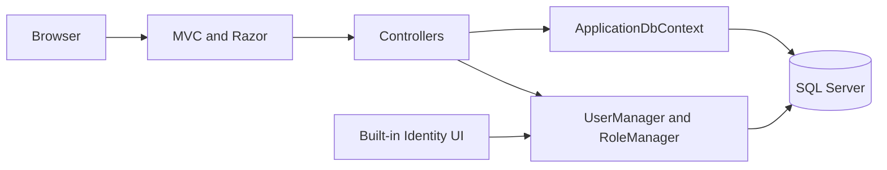
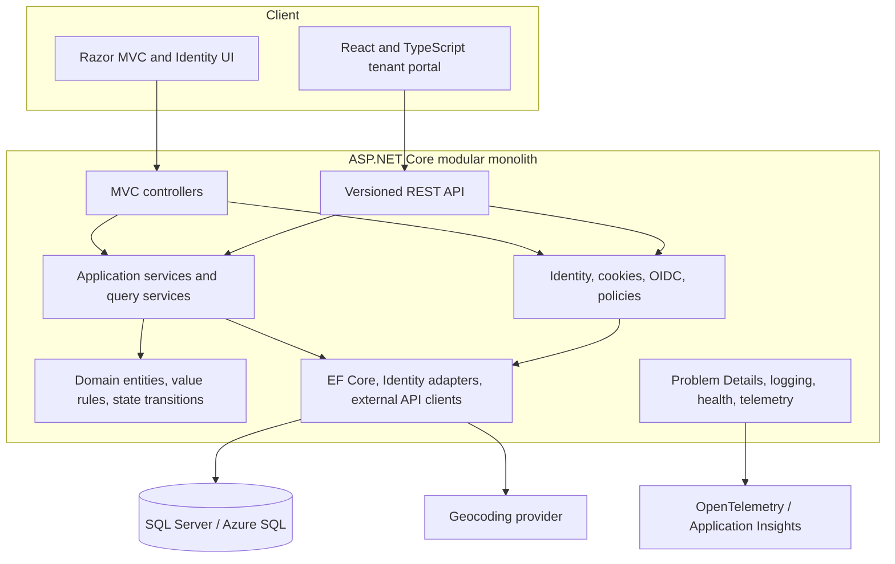
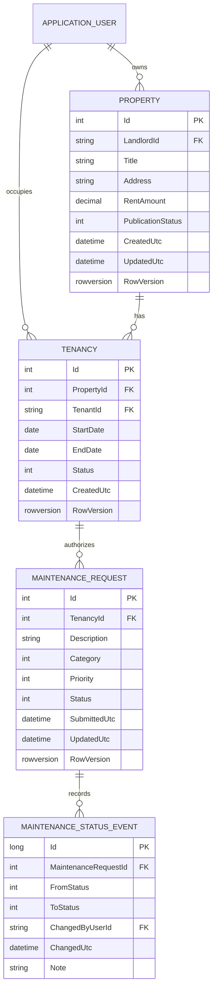
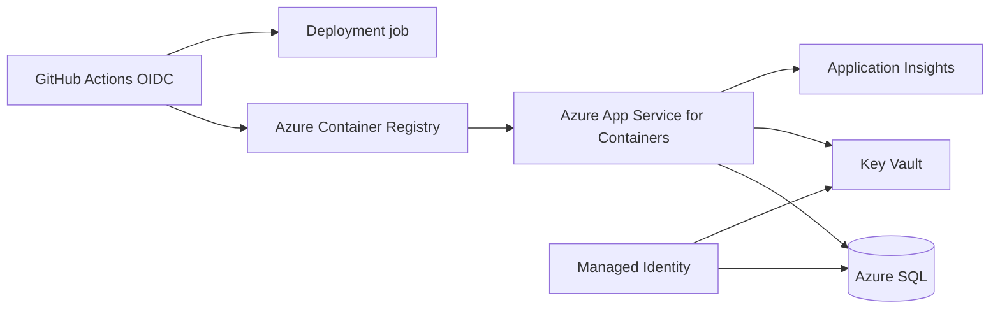

# RentRight architecture

Status: proposed target architecture based on repository inspection on 2026-08-11

## 1. Purpose and constraints

RentRight is a portfolio-scale property management application for administrators, landlords, and tenants. Its primary end-to-end scenario is:

1. a landlord owns and publishes a property;
2. a landlord or administrator establishes a tenancy with a tenant;
3. the tenant sees the active tenancy and submits a maintenance request;
4. the owning landlord triages and updates the request;
5. both parties see a trustworthy status history.

Architectural constraints:

- one deployable ASP.NET Core application;
- one SQL Server database;
- ASP.NET Core Identity remains the account store;
- working Razor UI is retained;
- React is introduced only where it adds portfolio and UX value;
- no microservices, message broker, custom identity server, or speculative distributed infrastructure;
- business rules must be usable by both MVC and API entry points;
- authorization is always enforced server-side against persisted resources.

## 2. Current architecture



The current design is a conventional early MVC application. It is workable at this size, but controllers currently combine HTTP concerns, queries, authorization decisions, entity mutation, and persistence. That coupling will make a second client (React/API) duplicate logic unless an application boundary is introduced first.

Current domain relationships:

```text
ApplicationUser (Landlord) 1 ---- * Property
ApplicationUser (Tenant)   1 ---- * MaintenanceRequest
Property                   1 ---- * MaintenanceRequest
```

The missing tenancy relationship is the main domain gap. A client can name a `TenantId` and `PropertyId`, but the model cannot prove that the tenant occupies that property.

## 3. Target architecture

### 3.1 Runtime view



This is a layered modular monolith, not a distributed system. MVC and API are transport adapters. Application services implement use cases and transaction boundaries. Domain types hold stable invariants. Infrastructure contains EF Core, Identity-specific behavior, and external clients.

### 3.2 Source organization

Start with logical boundaries inside the existing web project to avoid a disruptive rename or project explosion:

```text
RentRight/
├── Features/
│   ├── Properties/
│   │   ├── Contracts/
│   │   ├── Services/
│   │   └── Validation/
│   ├── Tenancies/
│   ├── Maintenance/
│   └── Administration/
├── Authorization/
├── Data/
│   ├── Configurations/
│   └── Migrations/             # retain current Migrations path unless intentionally moved
├── Integrations/
├── Controllers/
│   ├── Api/V1/
│   └── ... existing MVC controllers
├── Models/                     # domain/Identity entities during incremental migration
├── Views/
├── ClientApp/                  # Vite React + TypeScript
├── Program.cs
└── RentRight.csproj
```

The exact folder move should be incremental. Existing namespaces and migrations should not be churned merely to match the diagram. Split class-library projects only if compile-time dependency enforcement becomes valuable; it is not a prerequisite for clean service boundaries.

### 3.3 Dependency rules

- Controllers know HTTP, model binding, authorization results, and application-service contracts.
- Controllers do not contain EF queries, status-transition rules, role-assignment rules, or entity ownership mutation.
- Application services own use-case orchestration and transactions.
- Domain code does not depend on MVC, Identity managers, EF configuration, logging providers, or external API SDKs.
- Infrastructure may depend on domain/application contracts and framework implementations.
- Razor and React never determine authorization; they only tailor presentation after the server has authorized the operation.
- API contracts never expose EF entities, Identity entities, concurrency tokens without intent, or internal foreign keys that the caller does not need.
- EF Core remains the unit of work. Avoid generic CRUD repository abstractions.

## 4. Domain model

### 4.1 Proposed relationships



Names are proposals; the migration task should settle them before implementation.

### 4.2 Core invariants

#### Property

- A property has exactly one owning `ApplicationUser`.
- Only an admin or its owning landlord may change it.
- Only published/available properties appear in anonymous queries.
- Money uses explicit SQL precision and scale; strings have bounded lengths.
- A property with tenancy or maintenance history is archived/unpublished, not hard-deleted.
- `RowVersion` prevents silent lost updates.

#### Tenancy

- A tenancy connects one tenant-role account to one property for a defined period.
- Date ranges are valid (`EndDate` is null or not before `StartDate`).
- At most one active tenancy exists per property unless a later explicit multi-occupancy requirement is introduced.
- Only an admin or owning landlord may create/end a tenancy.
- Tenant acceptance should be explicit if the workflow exposes invitations. Until acceptance exists, an administrator-only assignment is safer than silently assigning arbitrary users.
- Historical tenancies are retained for authorization/audit history.

#### Maintenance request

- A request belongs to a tenancy, which is the authoritative tenant/property relationship.
- Only the tenant on an active tenancy may submit it.
- The tenant may read their request; the owning landlord and admins may read it.
- Status is a controlled value, not arbitrary text.
- Allowed transitions are centralized and tested. A minimal state machine is `Submitted -> InProgress -> Resolved -> Closed`, with explicitly designed reopen/cancel rules if needed.
- Every status transition records actor, time, previous/new status, and an optional bounded note.
- Concurrent updates return a conflict rather than silently overwriting.

#### Application user and roles

- Identity roles are coarse capabilities: `Admin`, `Landlord`, `Tenant`.
- A role alone never grants access to another user's property or tenancy.
- Admin override is explicit. If a user has both Admin and Landlord roles, the Admin policy wins rather than accidentally applying the landlord restriction.
- Self-registration never accepts a privileged role from the request.
- The system must preserve at least one usable administrator through a database-safe or serialized operation.

## 5. Application layer

Prefer use-case-oriented interfaces over generic CRUD services. Illustrative boundaries:

```csharp
public interface IPropertyService
{
    Task<PagedResult<PropertySummary>> SearchPublishedAsync(
        PropertySearchQuery query,
        CancellationToken cancellationToken);

    Task<Result<PropertyDetails>> GetAsync(
        int propertyId,
        UserContext user,
        CancellationToken cancellationToken);

    Task<Result<int>> CreateAsync(
        CreatePropertyCommand command,
        UserContext user,
        CancellationToken cancellationToken);
}
```

Equivalent focused services are expected for tenancy, maintenance workflow, dashboard queries, and role administration. `Result` here means a small, project-owned outcome type only if it improves consistent mapping; do not introduce a large mediator framework.

Useful narrow abstractions:

- `IClock` for deterministic UTC timestamps;
- `ICurrentUser` or an immutable `UserContext` created at the web boundary;
- `IGeocodingClient` for the optional external dependency;
- query/command DTOs for each use case.

Avoid interfaces for every EF entity or one-method class. Add seams where they isolate business rules, identity/framework behavior, time, or an external system.

## 6. HTTP and REST API

### 6.1 API shape

Initial route namespace: `/api/v1`.

Representative resources:

```text
GET    /api/v1/properties?status=published&page=1&pageSize=20
GET    /api/v1/properties/{propertyId}
POST   /api/v1/properties
PUT    /api/v1/properties/{propertyId}

GET    /api/v1/tenancies/mine
POST   /api/v1/properties/{propertyId}/tenancies
POST   /api/v1/tenancies/{tenancyId}/accept
POST   /api/v1/tenancies/{tenancyId}/end

GET    /api/v1/maintenance-requests/mine
POST   /api/v1/tenancies/{tenancyId}/maintenance-requests
GET    /api/v1/maintenance-requests/{requestId}
PATCH  /api/v1/maintenance-requests/{requestId}/status
```

Route shape should express resource relationships, while the service layer remains the authority. API endpoints should not accept `LandlordId`, `TenantId`, status-history actor, or timestamps from clients when those values derive from the authenticated user or server.

### 6.2 Contract conventions

P03-01 implements the shared conventions below in `RentRight.Api` and
`Controllers/Api/V1/ApiV1ControllerBase.cs`. The exact runtime contract, stable error
codes, pagination bounds, and browser request requirements are documented in
[`API.md`](API.md). P03-02 implements the property list/detail/create/update/delete
routes through the existing property service. P05-01 implements tenancy lifecycle
routes through ITenancyService; maintenance API routes remain future work.

- JSON uses a documented naming convention and ISO-8601 UTC timestamps.
- Use dedicated request and response DTOs with bounded validation.
- `201 Created` includes a location for successful creation.
- `204 No Content` is used for successful commands with no response body.
- `400` represents malformed input; `401` unauthenticated; `403` authenticated but disallowed; `404` missing or deliberately concealed resources; `409` state/concurrency conflicts; `429` rate limits.
- Errors use RFC 7807 `ProblemDetails` with a stable application error code and trace ID. Do not expose stack traces or SQL/provider details.
- Collection responses are paged and include documented pagination metadata.
- Cancellation tokens flow from HTTP through EF/external calls.
- OpenAPI is generated from the running contract and checked in CI for unexpected drift if practical.
- Versioning starts with URL versioning because it is explicit and simple for a portfolio client.

### 6.3 Concurrency

Expose an intentional opaque version value for mutable resources. A client submits it through `If-Match` or a documented DTO field. EF `DbUpdateConcurrencyException` maps to `409 Conflict` or `412 Precondition Failed` consistently. The response tells the client to reload; it never silently retries a business update with stale values.

## 7. Authentication and authorization

### 7.1 Authentication model

- ASP.NET Core Identity remains the local account/user/role store.
- The ASP.NET Core app issues the application cookie.
- A configured external OpenID Connect provider is an additional sign-in method, not a replacement account database or authorization server.
- External subject/provider keys link to a local Identity account. Roles remain local and are never trusted directly from arbitrary external claims without an explicit mapping policy.
- React is hosted on the same origin and uses the application cookie with `credentials: include`.
- Unsafe MVC and API requests require antiforgery validation. React obtains a request token through a small authenticated endpoint or host-page bootstrap and sends it in the documented `X-CSRF-TOKEN` header.
- Authentication secrets live in user secrets locally and Key Vault/environment configuration in Azure.

Do not add a custom JWT issuer. If a future separately hosted/mobile client creates a real bearer-token requirement, use a managed standards-compliant identity provider and document the new threat model.

### 7.2 Authorization matrix

| Resource/action | Anonymous | Tenant | Landlord | Admin |
|---|---:|---:|---:|---:|
| Read published property | Yes | Yes | Yes | Yes |
| Create property | No | No | Yes | Yes |
| Modify property | No | No | Owner only | Yes |
| Create/end tenancy | No | No | Owned property only | Yes |
| Read tenancy | No | Participant only | Owned property only | Yes |
| Submit maintenance | No | Active tenancy only | No | Optional support action only |
| Read maintenance | No | Own tenancy only | Owned property only | Yes |
| Change maintenance status | No | Limited close/reopen rule, if adopted | Owned property only | Yes |
| Change roles | No | No | No | Yes |

Implement coarse policies plus resource handlers. Services must also scope database queries by the current user so an identifier cannot bypass filtering. Integration tests should exercise every row, including multi-role users and object-ID enumeration.

### 7.3 Identity hardening

- Require confirmed accounts once an email delivery path exists.
- Configure password, lockout, cookie lifetime, secure/SameSite flags, and reauthentication for sensitive admin operations.
- Persist data-protection keys outside ephemeral container storage in Azure.
- Apply rate limiting to login-related and write-heavy endpoints without locking out normal navigation.
- Validate redirect URIs and external-login correlation behavior.
- Log security events using internal IDs and event names, not passwords, tokens, raw claims, request descriptions, or full addresses.

## 8. Persistence and query architecture

### 8.1 EF Core configuration

- Move database mapping toward `IEntityTypeConfiguration<T>` classes as entities gain constraints.
- Specify decimal precision, max lengths, Unicode requirements, enum conversions, UTC timestamps, delete behavior, and rowversion explicitly.
- Use `AsNoTracking()` and DTO projection for read-only queries.
- Keep write transactions short and scoped to one application service operation.
- Prefer server-side paging/filtering/sorting; never load all properties/users/requests for list pages.
- Avoid lazy loading. Load or project only required relationships.
- Inspect generated migrations and idempotent scripts. Do not auto-run production migrations from every application instance.

### 8.2 Initial index candidates

Indexes must be validated against real SQL and plans. Likely candidates based on planned query shapes are:

- `Property(LandlordId, PublicationStatus)` including display/sort columns where justified;
- `Property(PublicationStatus, CreatedUtc DESC)` for the public list;
- filtered unique active tenancy index on `Tenancy(PropertyId)`;
- `Tenancy(TenantId, Status)` for the tenant dashboard;
- `MaintenanceRequest(TenancyId, SubmittedUtc DESC)`;
- landlord work-queue support through tenancy/property/status joins, potentially a composite index selected after measuring;
- `MaintenanceStatusEvent(MaintenanceRequestId, ChangedUtc)`.

Every index has write/storage cost. Capture the target query and plan evidence in the migration/PR description.

### 8.3 Deletion and retention

Identity users, properties, tenancies, and maintenance records have audit/history value. Define archival/deactivation rather than cascading deletion across business history. If user deletion is required, define retention/anonymization separately; do not infer it from Identity cascade defaults. Replace the placeholder privacy page with the actual demo data policy before public deployment.

## 9. React architecture

Use Vite, React, and TypeScript in `ClientApp` with a development proxy to ASP.NET Core and production build output served by the web app.

Initial React scope:

- authenticated tenant home;
- active tenancy summary;
- maintenance request list/detail;
- submit-request form;
- clear loading, empty, validation, forbidden, not-found, conflict, and retry states.

Recommended client boundaries:

```text
ClientApp/src/
├── api/          # fetch wrapper, generated/hand-maintained API types, problem parsing
├── auth/         # current-session state only; no token storage
├── features/
│   ├── dashboard/
│   └── maintenance/
├── components/   # small reusable UI primitives
├── routes/
└── test/
```

Keep server state in a focused query library only if it materially reduces error-prone caching code; otherwise a small typed fetch layer is enough. Never put bearer tokens in `localStorage`. Accessibility and keyboard behavior are acceptance criteria, not a final polish task.

## 10. External integration

Geocoding is the recommended single third-party integration because it improves property data and demonstrates production HTTP-client behavior.

Architecture:

- `IGeocodingClient` application-facing contract;
- provider-specific typed `HttpClient` in infrastructure;
- validated options for base URL, credential reference, timeout, and feature flag;
- bounded retry only for transient/idempotent requests, timeout, cancellation, rate-limit handling, and circuit-breaking if the chosen stack supports it;
- cache normalized address results to control cost and latency;
- persist coordinates/provider reference only after validation;
- manual address entry and property management continue when the provider is unavailable;
- logs exclude credentials and minimize full-address exposure.

Do not call the provider during anonymous list rendering or on every read.

## 11. Errors, logging, and observability

- MVC uses a safe production exception page; APIs use `ProblemDetails`.
- A global exception handler maps known validation/not-found/forbidden/conflict outcomes and treats unexpected exceptions as internal failures.
- Use `ILogger` message templates with event IDs and fields such as request ID, user internal ID, entity ID, duration, and outcome.
- Do not log maintenance descriptions, access tokens, cookies, passwords, connection strings, or unnecessarily precise address data.
- Propagate W3C trace context. Export traces/metrics/log correlation through OpenTelemetry/Application Insights in Azure.
- Health endpoints are split into liveness (process) and readiness (database/required configuration). Optional geocoding/AI providers should not make the core app unready.
- Record request latency, error rate, dependency failures, and maintenance workflow counts without high-cardinality user content.

## 12. Testing architecture

### Unit tests

- xUnit tests domain transitions, date invariants, authorization decisions, application outcomes, mapping, and validation.
- Time comes from a fake `IClock`.
- Pure rules do not require EF or HTTP mocks.
- External clients are tested with a controlled HTTP handler, not a live provider.

### Integration tests

- `WebApplicationFactory<Program>` starts the real ASP.NET Core pipeline.
- A SQL Server Testcontainer supplies a disposable database so relational behavior, migrations, indexes, filtered constraints, and SQL-specific mappings are exercised.
- Test authentication creates explicit Admin/Landlord/Tenant principals; a smaller set also exercises real Identity cookie behavior.
- Tests cover `401`, `403`/concealed `404`, CSRF, ownership, multi-role cases, validation, status transitions, concurrency, and Problem Details.
- Each test owns/reset its data. Tests must run in parallel safely or explicitly serialize database fixtures.

### Frontend tests

- Vitest and React Testing Library cover form validation, API problems, loading/empty/error states, permissions, and accessible names.
- A very small browser smoke suite may be added after the stack is stable; broad brittle end-to-end coverage is not an early priority.

## 13. Build, deployment, and operations

### Local

- Multi-stage Dockerfile builds React then publishes ASP.NET Core.
- Runtime image is pinned, minimal, and runs as non-root.
- Docker Compose runs the application and SQL Server with health checks, environment overrides, and a named database volume.
- Development secrets are supplied out of source control; checked-in settings contain safe defaults only.

### CI and release

- Pull requests restore deterministically, build with warnings enforced, run backend tests, run frontend lint/type/test/build, validate formatting, and build the container.
- Dependency/security checks are actionable and version-pinned; avoid noisy gates with no response process.
- Main creates an immutable image tagged with the commit SHA and publishes an artifact/SBOM as appropriate.
- GitHub environments and workload identity gate Azure deployment. Do not store publish profiles or long-lived service-principal secrets.

### Azure target



Bicep should provision the smallest useful topology: resource group-scoped modules for registry (if needed), Linux App Service/plan, Azure SQL, Key Vault, Application Insights/Log Analytics, managed identity, and role assignments. Use a separate migration command/job before slot/startup promotion. Define backups, minimum TLS, allowed network access, and cost-aware SKU parameters.

## 14. Architecture decisions to record

Create short ADRs as these decisions are implemented:

1. modular monolith and in-project application boundaries;
2. tenancy as the authorization root for maintenance;
3. same-origin cookie authentication and antiforgery for React/API;
4. SQL Server Testcontainers for integration fidelity;
5. archive versus delete policy;
6. external OIDC provider and local role ownership;
7. chosen geocoding provider and fallback behavior;
8. Azure App Service deployment and explicit migration job;
9. AI privacy/human-review decision, only if Phase 14 proceeds.

## 15. Non-goals

- Microservices or independent scaling boundaries.
- Rent collection, payments, accounting, legal document signing, applicant screening, or housing decisions.
- A public developer platform or OAuth authorization server.
- Replacing all Razor/Identity UI with React.
- Native mobile apps.
- Real-time chat or notification infrastructure.
- High-scale multi-region, sharding, event sourcing, or eventual-consistency design.

## Implemented P05-01 lifecycle decision (2026-10-16)

The earlier diagrams are target proposals; the running schema remains authoritative.
No separate Phase 1 ADR exists in this checkout; its manual verification document
records the one-Active-per-property decision. P05-01 preserves that invariant and
strengthens the reservation index to one Pending **or** Active row per property.

`ITenancyService` handles capabilities, input validation, time and token issuance;
`ITenancyStore` implements scoped projections and transactional SQL commands.
`Tenancy` centralizes accept/end transition rules. MVC and API use the same boundary.
A single row represents an invitation, accepted occupancy and ended history, so
nullable fixed audit fields truthfully record each once-only transition without a
new generic audit/event subsystem. Legacy rows keep null audit values; historical
consent and actors are never fabricated. TenantId is nullable for unknown/ineligible
invitation targets, while a SQL check requires it for Active occupancy. New Pending
rows require hash, expiry and invitation actor/time. Pending/cancelled projections
hide account details, preserving the same observable outcome for arbitrary account
identifiers. Identity's exact unique normalized login identifier avoids ambiguous
email matches. Only a matching account already eligible at issuance can consent;
SQL rechecks Tenant membership at acceptance.

Tokens use 32 cryptographically random bytes; only a SHA-256 hash is persisted.
The raw token is returned once on a no-store issuance response and submitted in a
POST body. It is absent from URLs, lists, detail, audit and logs. No email provider
or recovery mechanism is added. Transport/operational limits and manual verification
are documented in [TENANCY_LIFECYCLE.md](TENANCY_LIFECYCLE.md).

A serializable transaction obtains UPDLOCK/HOLDLOCK on the persisted Property before
reading or mutating lifecycle state, serializing create/accept/end and property
ownership/deletion changes. The combined filtered unique index prevents reservation
collisions even outside the service. SQL rowversion rejects stale tracked writes;
deadlocks, unique collisions and EF concurrency failures map to conflict, without
blind retries. P07-02 adds an opaque expected version to end/cancel so a form
read before acceptance cannot end the newly accepted tenancy without review.
Acceptance retains its one-use immutable invitation token and locked Pending
precondition. Second acceptance/ending never rewrites original audit values.

All existing properties are treated as lifecycle-available subject to reservations:
archive/publication state does not exist yet. Historical rows are never deleted.
Maintenance status/history is implemented in P05-02/P05-03. P07-02 extends
rowversion to properties and maintenance and defines retained-history SQL guards;
see [CONCURRENCY_RETENTION.md](CONCURRENCY_RETENTION.md).
