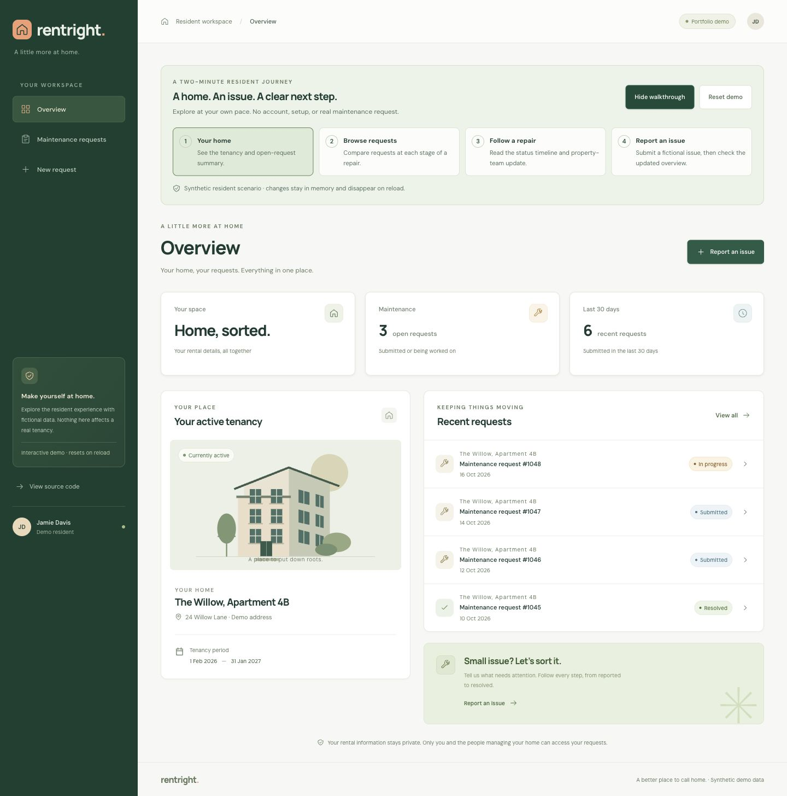
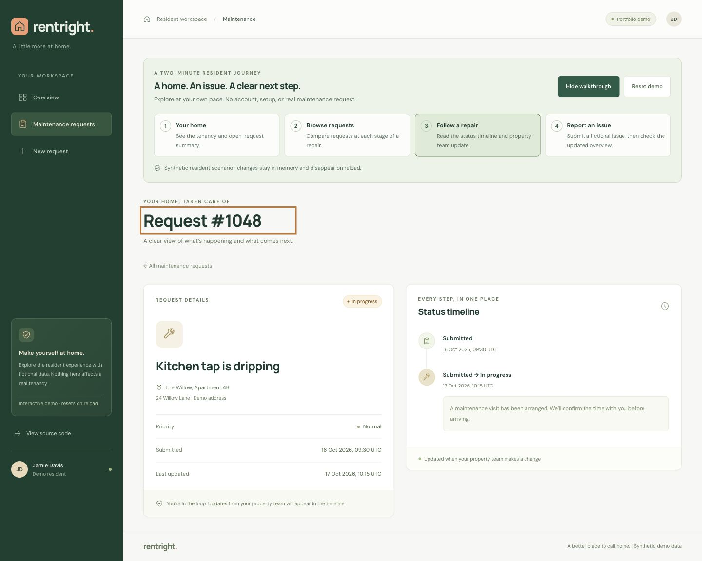

# RentRight — a rental workflow, not just a dashboard

RentRight brings property listings, tenancy invitations, and maintenance tracking
into one application. The focus is a complete journey: a tenant reports an issue,
the owning landlord works it through controlled statuses, and the tenant can
follow the recorded updates. Administrators manage the wider portfolio and roles.

**Stack:** React, TypeScript, ASP.NET Core 10, Identity, EF Core, SQL Server, Docker,
and GitHub Actions. One deployable application, not a microservice system.

## Try it in two minutes

With Node 24 selected, from the repository root:

```sh
npm ci --prefix ClientApp
npm run demo --prefix ClientApp
```

Open <http://127.0.0.1:4173/app/demo/> and select **Show walkthrough**:

1. **Your home:** inspect the active tenancy and three open requests.
2. **Browse requests:** compare submitted, in-progress, resolved, and closed issues.
3. **Follow a repair:** read the kitchen tap's chronological status timeline.
4. **Report an issue:** submit fictional text, then return to **Your home** to see
   the open count increase. **Reset demo** offers confirmation before restoring
   the original six-request scenario and clearing unfinished text.

This is explicitly a **tenant UI simulation**, not a backend, login, or landlord
demo. It uses the real tenant presentation components with an in-memory adapter.
It makes no API requests, stores no browser data, and never touches a real tenancy.
Reloading also restores the fixed October 2026 scenario. Use fictional text only.



## Engineering decisions worth discussing

- **Authorization follows the tenancy.** A maintenance request is related to a
  tenancy, rather than trusting a submitted tenant/property ID. Resource-aware
  services and database queries enforce tenant isolation, landlord ownership, and
  administrator access. See [the authorization design](AUTHORIZATION.md) and
  [the tenant maintenance service](../Features/Maintenance/TenantMaintenanceService.cs).
- **A repair has a lifecycle.** Centralized transitions, immutable status history,
  rowversion conflicts, and SQL constraints protect the workflow beyond the UI.
  See [concurrency and retention](CONCURRENCY_RETENTION.md) and
  [SQL integration tests](SQL_INTEGRATION_TESTS.md). The simulated timeline is
  illustrative; it does not prove a backend transition occurred.
- **Keep the architecture proportionate.** React business screens and a versioned
  API share one ASP.NET Core host, with Identity account screens and retained MVC
  compatibility routes. Cookies and antiforgery protection avoid inventing a
  browser token server. Focused services own workflows; EF remains the data layer.
  See [React workspace boundaries](REACT_BUSINESS_WORKSPACES.md).
- **Test the real persistence boundary.** Disposable SQL Server integration tests
  complement fast unit/HTTP tests; query tuning has recorded measurements, not
  just index claims. See [query evidence and its limitations](performance/QUERY_PERFORMANCE.md).
- **Separate a build from a deployment.** PR checks cover frontend, backend, SQL,
  and containers. Private image publication is manually approved and distinct
  from cloud hosting or migrations. See [CI](CI.md) and [release boundaries](RELEASES.md).



## Evidence and honest limits

The guided-demo follow-up on 2026-10-23 passes 91 frontend tests, lint, strict
TypeScript, both production/static builds, and a dependency audit with no reported
vulnerabilities. Its six new journey tests cover navigation, confirmation,
cancelled-reset focus/text preservation, same-route reset, stale request links,
browser route changes, live-route separation, and hiding the guide without data loss.

Browser verification exercised the simulated submit → updated count → reset
journey, observed zero API requests or failed requests, checked keyboard/drawer
focus, and sampled 320px, 390px, 768px, and 1440px layouts without horizontal
overflow. These are targeted checks, not a comprehensive accessibility audit.
The [showcase report](PORTFOLIO_SHOWCASE.md) records the exact verification scope.

Azure hosting is deferred by choice. There is no public full-stack deployment,
paid infrastructure, external-login integration, or AI triage claim. The next
operational work is observability and readiness; it is not hidden by this demo.
The full stack is reproducible locally through the [HTTPS Compose runbook](LOCAL_COMPOSE.md),
using private development credentials rather than shared permanent admin access.

For a portfolio gallery, use the [desktop overview](showcase/guided-overview-desktop.png),
[repair timeline](showcase/guided-timeline-desktop.png), and
[mobile overview](showcase/guided-overview-mobile.png). All are unedited browser
captures with synthetic data and visible demo disclosure. Static export and
hosting-path requirements are in the [showcase guide](PORTFOLIO_SHOWCASE.md).
